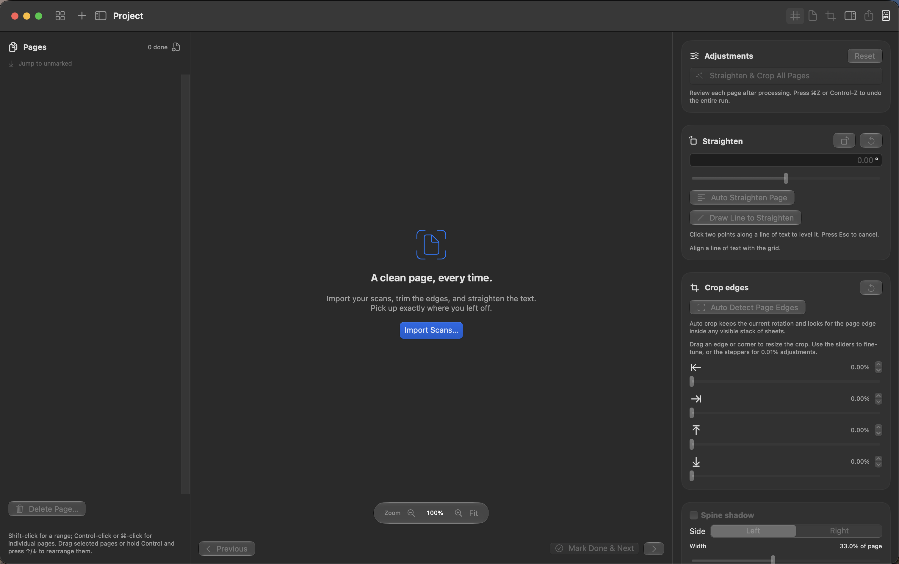

# Scan Cleaner

Scan Cleaner is a Mac app for turning scanned book pages into a searchable PDF. Scan cleanup and text recognition run on your Mac.



## What it does

- **Import and organize scans.** Open PNG, JPEG, TIFF, HEIC, or BMP page images, reorder them, and mark pages as reviewed. Progress saves automatically, and your original files stay intact.
- **Straighten and crop in batches.** Automatically straighten text and detect page edges across the book, then fine-tune individual pages.
- **Lighten spine shadows.** Adjust the left or right edge and apply settings to odd or even pages to handle facing pages.
- **Export searchable PDFs or full-resolution PNGs.** Preview PDF compression, set a file-size target, and add book details manually or through ISBN lookup.

## Install

Requires an Apple silicon Mac (M1 or later) running macOS 14 or later.

### Download the app

1. Open the [latest release](https://github.com/brianalewine/Scan-Cleaner/releases/latest) and download **Scan-Cleaner-1.3-macOS-arm64.dmg** under **Assets**. The source-code archives do not contain the built app.
2. Open the DMG and drag **Scan Cleaner.app** onto **Applications**, then eject the disk image.
3. Open **Scan Cleaner** from Applications.

The app is ad-hoc signed and is not notarized by Apple. If macOS blocks the first launch, open **System Settings → Privacy & Security**, scroll to the message about Scan Cleaner, click **Open Anyway**, and confirm **Open**. You may need to try opening the app once before this option appears.

If macOS reports that the app is damaged or still refuses to open it, and you trust the download from this repository, run this in Terminal, then open the app again:

```sh
xattr -dr com.apple.quarantine "/Applications/Scan Cleaner.app"
```

To update, quit Scan Cleaner and replace the copy in Applications with the new download.

### Build from source

With Xcode 26 or later installed, run:

```sh
./scripts/build.sh
```

This creates **Scan Cleaner.app** in the project folder. Open it there or drag it into Applications.
